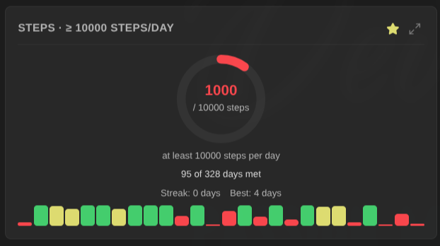

# Visualizations

Life Tracker supports 13 visualization types, each suited for different kinds of data.

## Cartesian Charts

These charts plot data over time with X and Y axes.

### Line Chart

Best for: Tracking trends over time

- Shows data points connected by lines
- Ideal for continuous numeric data
- Supports multiple datasets (overlays)
- Good for: mood tracking, weight, temperature

### Bar Chart

Best for: Comparing discrete values

- Vertical bars for each time period
- Good for counts and totals
- Supports multiple datasets (overlays)
- Good for: exercise duration, calories, steps

### Area Chart

Best for: Showing volume over time

- Filled area under the line
- Emphasizes magnitude of change
- Supports multiple datasets (overlays)
- Good for: sleep hours, screen time, reading time

### Scatter Chart

Best for: Showing distribution

- Individual points without connections
- Plotted against a real date axis, so points sit at their actual position in time and the tooltip shows the exact date
- Good for sparse or irregular data
- Shows data density patterns
- Good for: irregular measurements, event occurrences

### Bubble Chart

Best for: Multi-dimensional data

- Points with variable size
- Size represents a third dimension
- Good for: data with magnitude variations
- Hovering a bubble shows the value and the exact number of entries in that period

Chart tooltips show whole-number values without trailing decimals, so counts like habit completions read as `3` rather than `3.00`.

### Range Chart

Draws one floating bar per period, spanning from a **start** property's value
to an **end** property's value — sleep from "To Bed" to "Wake Up", work hours
from "Start" to "End", or any numeric spread.

- Range charts combine two properties, so they are created as overlays: see
  [Overlay Charts](overlays.md#range-charts).
- Values can be times of day (`23:30`), datetimes, or plain numbers. If any
  value is a time, the axis and tooltips read as clock times (`HH:mm`).
- Spans that end "before" they start cross midnight and are drawn into the
  next day, so a 23:30 → 07:15 night renders as one continuous bar.

## Circular Charts

These charts show proportions and distributions.

**Colors match the heatmap**: when the segments are numeric values (a 1-5 mood, a rating), pie, doughnut, and polar area charts color each segment with the same value → color scale a heatmap of that property uses — the view-wide heatmap color scheme, or the default derived from the property's value direction — so the same value looks the same in both visualizations. Picking an explicit color scheme on the chart card overrides this, and non-numeric values (categories, tags) keep the regular chart palette.

### Pie Chart

Best for: Part-to-whole relationships

- Circular chart divided into slices
- Shows percentage of total
- Best with 2-6 categories
- Good for: time allocation, category distribution

### Doughnut Chart

Best for: Part-to-whole with emphasis

- Pie chart with hollow center
- Center can show total or label
- More modern appearance
- Good for: budget breakdown, task categories

### Polar Area Chart

Best for: Comparing magnitudes

- Like pie but segments have equal angles
- Radius shows magnitude
- Good for comparing values across categories
- Good for: ratings, scores, performance metrics

### Radar Chart

Best for: Multi-variable comparison

- Spider/web chart pattern
- Each axis represents a variable
- Shows balance across dimensions
- Good for: skill assessments, balanced scorecards

## Specialized Visualizations

### Heatmap

Best for: Daily patterns over time

- GitHub-style contribution graph
- Color intensity shows value magnitude
- Shows gaps and streaks clearly
- Good for: habit tracking, daily ratings, streaks

**Color schemes**: Green, Blue, Purple, Orange, Red, plus **Viridis** and **Cividis** — two colorblind-friendly gradients that also stay readable in grayscale.

**Custom color mapping**: for scales where each value means something specific (mood 1-5, energy levels, a rating), a single-hue gradient makes 2 and 3 nearly indistinguishable. Right-click the card, set **Colors** to **Custom mapping…**, and give each value its own color. A new mapping starts with values 1-5 on a colorblind-friendly ramp, so it is usable straight away. Values you have not mapped use the **fallback color**, and the legend lists one labelled swatch per entry instead of the "Less → More" ramp. The mapping belongs to that card, so two heatmaps of the same property can be colored differently.

**Aggregation**: when several notes fall in the same cell period, their values are combined by **Average** (default) or **Sum**. Use Sum for counter-style tracking like calories or sessions per day. Set it from the card's right-click menu.

**Streak stats**: a compact row below the legend shows your current streak, best streak, and total active periods. A period counts toward a streak when it has a recorded value other than 0 (matching the heatmap rendering, where 0 on a 0-based scale shows as empty). The current streak still counts if today's data isn't captured yet. Toggle the row with the **Show streak stats** view option.

### Tag Cloud

Best for: Text/tag frequency

- Words sized by frequency
- Shows most common values
- Great for tags and categories
- Good for: tags, activities, locations

### Timeline

Best for: Event sequences

- Events plotted on a time axis
- Shows when things happened
- Good for sparse events
- Good for: milestones, achievements, events

### Progress Ring

Best for: Goals you either hit or miss

- Circular progress toward a target for the period you are **currently in**
- Colors follow the goal's direction: a "reach it" goal runs red → yellow →
  green as the ring fills, a "stay under" budget runs green → yellow → red
- The hit rate and your current/best streak sit below the ring, with a strip of
  bars for the last 26 periods
- Good for: "3 days a week", "150 reps a week", "10 000 steps a day", "at most
  80 kg"

A progress ring needs a target — see [Goals and Targets](#goals-and-targets)
below. Until one is set, the card shows a prompt instead of a chart.

## List Property Support

For properties containing arrays/lists (like tags):

**Circular charts** (Pie, Doughnut, Polar Area):

- Count occurrences of each unique value
- Show distribution across all entries

**Cartesian charts** (Line, Bar, Area, Radar):

- Create one dataset per unique value
- Show 0/1 presence per time period
- Legend identifies each value

## X-Axis Source

Line, bar, and area charts normally group entries into time periods. The
**X-axis** option in the card's right-click menu offers an alternative:

- **Date** (default): group entries by period via the date anchor.
- **Date, one point per note**: every note is plotted at its own date, on an
  axis where distance is time. Nothing is grouped: two runs on the same day are
  two points, placed side by side within that day so you can hover or open
  each one, and a three-week break shows as a three-week gap. Date labels are
  short, horizontal, and thinned out so they never overlap. Notes without a
  date can't be placed; the card says how many were left out ("3 notes without
  a date"). Notes without a value are not drawn. Hover a point to see
  its date and note name; on this axis the tooltip shows the point nearest to
  the cursor. Bar charts get bars between 3 and 16 pixels wide.
- **Note name**: one point per note, labeled with the note's name, in the
  Base view's own sort order — sort the view to arrange the axis. Entries
  don't need a date, which makes this ideal for Bases whose notes aren't
  date-shaped (books with ratings, projects with scores, people). A trailing
  type suffix in parentheses is left off the axis label
  (`2025-06-24 (Running Session)` reads `2025-06-24`), and labels are thinned
  out instead of overlapping. The tooltip keeps the full name.

On both per-note axes nothing is grouped by time, so the Aggregation setting
does not apply. The moving average, running total, and trend indicator work
over notes instead of periods (in date order on the date axis), and the trend
row says so ("vs previous 7 notes"). With a running total, a goal target
climbs over the time your notes span on the date axis. The note-name axis has
no time, so it draws no cumulative target. List-valued properties keep the
date axis.

Export CSV on the **Date, one point per note** axis writes one row per note:
its date, its full name, then the value.

## Scale Configuration

For numeric visualizations, configure the Y-axis scale:

| Preset | Range    | Use Case                  |
| ------ | -------- | ------------------------- |
| Auto   | Dynamic  | Let the chart determine   |
| 0-1    | 0 to 1   | Percentages, ratios       |
| 0-5    | 0 to 5   | 5-point scales            |
| 1-5    | 1 to 5   | Rating scales (no zero)   |
| 0-10   | 0 to 10  | 10-point scales           |
| 1-10   | 1 to 10  | Rating scales (no zero)   |
| 0-100  | 0 to 100 | Percentages, large ranges |

A custom scale (**Custom...**) sets your own minimum and maximum.

### Outliers

On line, bar, and area charts with an **Auto-detect** scale, one far-off value
no longer sets the whole axis. A pace of 49997 seconds among runs around 6:20
used to stretch the axis to 50,000 and flatten every real run into a line at
the bottom. Now the axis fits the bulk of your data, and values far outside it
are drawn at the edge of the axis with a small triangle (pointing up for a
value above, down for a value below). Hover the point to see its real value,
marked "outside the scale". Clicking it opens the note, so you can fix the
typo.

What counts as far off: values more than three interquartile ranges beyond
the middle half of the data (Tukey's "far out" fences), checked only when the
series has at least 8 values. Ordinary highs and lows stay on the scale.

When most values are the same (10 minutes of meditation nearly every day), the
middle half has no spread, so a second rule takes over: a value more than 10
times the usual value counts as far off. One typo of 1000 among your 10s no
longer sets a 0 to 1000 axis. Low values never count as far off under this
rule: a missed day or a short session is real data.

Checkbox properties, and any series with only 0s and 1s, never have outliers:
a yes/no habit is drawn and averaged exactly as logged.

- The trend, the moving average, records, and CSV export use the real values,
  unless you switch **Leave outliers out of the average** to **On** in the
  card's right-click menu. Then the moving average and the trend ignore the
  far-off values. The points stay on the chart (as triangles at the edge when
  the scale is fitted), and records and CSV still use them.
- Running totals, list properties, and moving averages are never trimmed.
- To see every value, set **Outliers** to **Show all values** in the card's
  right-click menu (or in the overlay editor). A fixed scale (a preset or
  **Custom...**) always wins over both.
- Hiding a series by clicking its legend entry hides its triangles too.

## Value Format

Some values are durations stored as plain numbers: a pace in seconds per
kilometer, sleep in minutes. Set **Value format** in the card's right-click menu
to read them as times:

| Value format              | Stored value | Shown as |
| ------------------------- | ------------ | -------- |
| Number (default)          | 387          | 387      |
| Duration: seconds as m:ss | 387          | 6:27     |
| Duration: seconds as m:ss | 3725         | 1:02:05  |
| Duration: minutes as h:mm | 95           | 1:35     |

From one hour on, seconds read as `h:mm:ss`.

The format applies everywhere the card shows a value: axis ticks (which land
on round times such as 5:00, 5:30, 6:00), tooltips, the moving average,
default reference line and target labels, the record chip ("Record: 5:12"),
heatmap tooltips, and progress ring amounts. It changes only how values read:
the trend row keeps its percentage, and CSV export keeps the raw numbers so a
spreadsheet can still compute with them. Negative values are shown as plain
numbers.

On line and area charts, a duration axis fits your data instead of starting
at zero, so a pace between 5:00 and 7:00 fills the chart. Bar charts always
start at zero.

Progress rings and target lines format the amounts of **sum**, **average** and
**latest** targets; **count** and **days** targets count entries or days and
stay plain numbers ("Target: 3").

The format is offered for heatmap, line, bar, area, scatter, bubble and
progress cards, and is stored in the view's configuration in the `.base` file
(`valueFormat: duration-mm-ss` or `duration-h-mm`), so it travels with the
Base.

## Card Titles

A card shows its property's name. When several cards show the same property
(a "Run days" heatmap, a progress ring, and a "Distance per run (km)" chart),
they all carry that one name. Give each its own title: right-click the card,
choose **Card title…**, type the title and select **Apply**. Leave the field
empty to show the property's name again. The title is saved as `title` on that
card in the `.base` file.

The title is used everywhere the card shows its name, including maximized mode
and export file names, and a progress ring adds its goal after it ("Run days ·
≥ 3/week"). Overlay charts keep the name you give them in the overlay
editor.

## Color Schemes

Available for all chart types (except Tag Cloud):

- **Green**: Default, nature-inspired
- **Blue**: Cool, calming
- **Purple**: Creative, premium
- **Orange**: Warm, energetic
- **Red**: Bold, attention-grabbing
- **Colorblind-friendly**: eight colors chosen to stay distinguishable with any
  common form of color vision deficiency — use it whenever a chart shows several
  series at once, since the other schemes vary only in lightness

Heatmaps have their own list instead: the five schemes above plus **Viridis** and
**Cividis** (both colorblind-friendly), and **Custom mapping…** for exact
value-to-color control. See [Heatmap](#heatmap).

## Reference Lines

For cartesian charts only (Line, Bar, Area):

- Add horizontal lines at threshold values
- Useful for limits and milestones
- Custom labels (defaults to "Reference: {value}")
- Color matches the dataset
- Drawn together with the goal target's line when both are configured: the
  target uses a tighter dash and anchors its label at the left edge, the
  reference line at the right

Example uses:

- Weight goal line
- Minimum sleep target
- Exercise duration target

## Goals and Targets

Set a goal on any card through the right-click menu → **Configure target**. A
target reads as one sentence:

> _\<measure\>_ per _\<period\>_ must be _\<at least / at most\>_ _\<value\>_

| Measure               | Meaning                                                | Example goal                 |
| --------------------- | ------------------------------------------------------ | ---------------------------- |
| Entries with a value  | Notes with a value (one per note)                      | "Push-ups on 3 days a week"  |
| Days with a value     | Days with a value; several notes on one day count once | "Push-ups on 3 days a week"  |
| Total of the values   | Volume added up                                        | "150 squats a week"          |
| Average of the values | Mean over the period                                   | "Average mood of at least 7" |
| Most recent value     | The last reading                                       | "At most 80 kg"              |

Values logged as `0` count for neither "entries with a value" nor "days with a
value": writing `push_ups: 0` records that you did **not** do it, so a "3 days
a week" goal is not satisfied by logging zeros every day.

Entries and days only differ when several notes share a day. If your push-ups
live in session notes, a day with a gym session and a "Through the day"
session is 2 entries but 1 day. For a days-a-week goal, pick "days with a
value".

Targets belong to a visualization, not to a property, so one property can carry
two goals side by side: a consistency ring (days a week) and a volume ring (reps
a week). The goal appears in the card title so the two stay distinguishable.

Supported by the progress ring and by Line, Bar and Area charts, which draw the
target as a horizontal reference line. An explicitly configured reference line
takes precedence over the target's.

### Colors

The ring colors itself from the goal's direction, so filling it always reads
the right way round:

| Goal                 | Empty ring | Approaching | At the target     |
| -------------------- | ---------- | ----------- | ----------------- |
| At least (reach it)  | Red        | Yellow      | Green             |
| At most (stay under) | Green      | Yellow      | Red once exceeded |

The yellow warning band needs a meaningful zero to measure against, so it only
applies to "entries with a value", "days with a value" and "total of the
values". A weight of 79 against an 80 kg ceiling is not "99% of a budget" — that
scale does not start at zero — so "average" and "most recent value" goals are simply met or missed.

If you have set a property's **value direction** in the plugin settings
(_higher is better_ / _lower is better_), it preselects the matching goal
direction when you create a target, and warns you if you pick the opposite. It
does not override the colors: the direction you chose is the explicit statement
of what you want, and most properties carry no value direction at all.

### Periods with nothing recorded

For "entries with a value", "days with a value" and "total of the values", an
empty period is a real zero: doing nothing all week genuinely is 0 days and 0
reps, and the ring turns red.

For "average" and "most recent value" it is _unknown_ instead. A week you forgot
to weigh yourself shows a grey ring and a dash — not a weight of 0 kg, which
would otherwise satisfy an "at most 80 kg" goal every time you skipped the
scale. Those periods are left out of the hit rate as well.

## Personal Records

Properties with a **polarity** (see value polarity in
[Configuration](configuration.md)) show their personal best: a
"🏆 Record: value (date)" chip below single-dataset line, bar, and area
charts, and in the heatmap's streak row.

- **Higher is better** records the maximum; **lower is better** the minimum.
- Neutral properties show nothing — without a direction there is no "best".
- The record reads raw entry values, not period aggregates: "longest
  meditation: 30 min" is a single session, not a daily average.
- When new data beats the record displayed earlier in the session, a
  "🏆 New record!" notice celebrates it.

### Checkbox properties: completion instead

A record over a checkbox would always be "true", so checkbox properties get a
completion chip in the same spot instead:

    ✅ Checked: 42/90 days (47%)

That is how many of the periods **on screen** were ticked — 42 of the 90 days
the visualization covers — not how many days you remembered to write the
property down. A day with no entry counts as a day it was not done, which is
what makes the number honest for a habit you only log when you do it.

The unit follows the granularity, so a weekly chart counts weeks. Completion
needs no polarity: it counts periods rather than calling any of them best.

## Moving Average

For line and area charts, enable a moving average from the card's right-click menu (7, 14, or 30 periods). It smooths noisy metrics like mood, weight, steps, or pace. Each point is the mean of the recorded values in the trailing window — missing periods are skipped, not counted as 0.

When the moving average is on, it becomes the main line: solid, thicker, in full color, drawn on top, and listed first in the legend and tooltip. Your raw values stay visible as a thin, faded line behind it. On the per-note axes the window counts notes ("7-note average").

The average never reaches across a gap in your data (see [Gaps in the line](#gaps-in-the-line)): after a long break it starts again from the first new value. To keep one bad value from pulling the average off course, switch **Leave outliers out of the average** to **On** (see [Outliers](#outliers)).

## Gaps in the line

Line and area charts on a date axis (**Date** or **Date, one point per note**) stop the line when two points are far apart in time. Without this, a running pace card with no runs from December to February drew one straight line across the winter, and its moving average drew a flat stretch.

Two points are far apart when they are further apart than 3 times the usual spacing between your points, or 14 days, whichever is longer. For daily data, a break of more than two weeks stops the line. For monthly data, a break of more than about three months does.

The raw line, the area below it, and the moving average all stop at the gap. The points themselves stay where they are.

This is on by default. To keep one continuous line, set **Break line across gaps** to **Off** in the card's right-click menu (`breakLineAcrossGaps: false` in the `.base` file). The **Note name** axis has no dates, so its line never breaks. Overlay charts keep one continuous line, and the overlay editor has no **Break line across gaps** switch.

## Running Total

For line and area charts, switch **Running total** to **Enabled** in the card's right-click menu to plot the cumulative total instead of the per-period value. A `pages_read` of 20, 15, then 30 is drawn as 20 → 35 → 65, so you can see progress toward a long-term goal instead of session-by-session values. It works for any numeric property: pages read, distance covered, money saved, tasks completed.

A few details worth knowing:

- Values recorded in the same period are combined by the **Aggregation** setting first, then the periods accumulate. "Sum" is usually what you want here.
- The total starts from zero at the left edge of the visible range, so a time frame like **Last 30 days** totals just that month rather than carrying in earlier history.
- A note that exists but records no value holds the line flat rather than breaking it, since your total has not changed. Periods with no note at all are not plotted — they are not part of the chart either way, with or without a running total.
- The legend and CSV export label the series `(running total)`, since it no longer shows the raw property value.
- A reference line now reads as a target total, which is handy for goals like "500 pages this year".
- A **goal target** whose period matches the chart's granularity accumulates alongside the data: "50 per day" draws as a line climbing 50 a day, labeled `(cumulative)`, so you can see whether the total keeps pace with the goal. A target with a different period (e.g. "per week" on a daily chart) has no honest slope on that axis and is not drawn while the running total is on.
- The trend arrow keeps describing your per-period rate, not the total, and the trend row is labeled **Per-period trend** to make that explicit. A cumulative line always climbs when the values are positive, so a trend taken from it would only restate that; "steady 10 a day" reports as flat, which is what you want to know. A ↓ next to a rising total is not a contradiction: your total grew, but by less than in the previous periods.
- Clicking a point opens a note from that period, not from everything the total has accumulated so far.
- Only numeric properties get this option. List-valued properties are charted as one line per value, which has no total to accumulate.

## Trend Indicator

Single-dataset line, bar, and area charts show a small ↑ / ↓ / → arrow next to the card title, plus a trend row below the chart (e.g. `Trend: ↑ +12.3% · vs previous 7 periods`), comparing the average of the most recent periods (up to 7) against the previous ones. Hover the arrow for the same detail. The display stays neutral in color, since whether "up" is good depends on what you track. Toggle it with the **Show trend** view option.

## Exporting

Right-click any visualization card (long-press on mobile) to export it:

- **Export image**: saves a PNG of the chart in its current state. Available for chart types (line, bar, area, pie, doughnut, radar, polar area, scatter, bubble).
- **Export CSV**: saves the data exactly as displayed — chart periods and values, heatmap dates/values/entry counts, tag frequencies, or timeline points. Values are raw numbers, even when the card shows them as durations, and values drawn at the edge of the axis are exported with their real value.

Exported files are named after the card's title.

Files are saved to your vault's attachment folder, and a notice shows the exact path.
